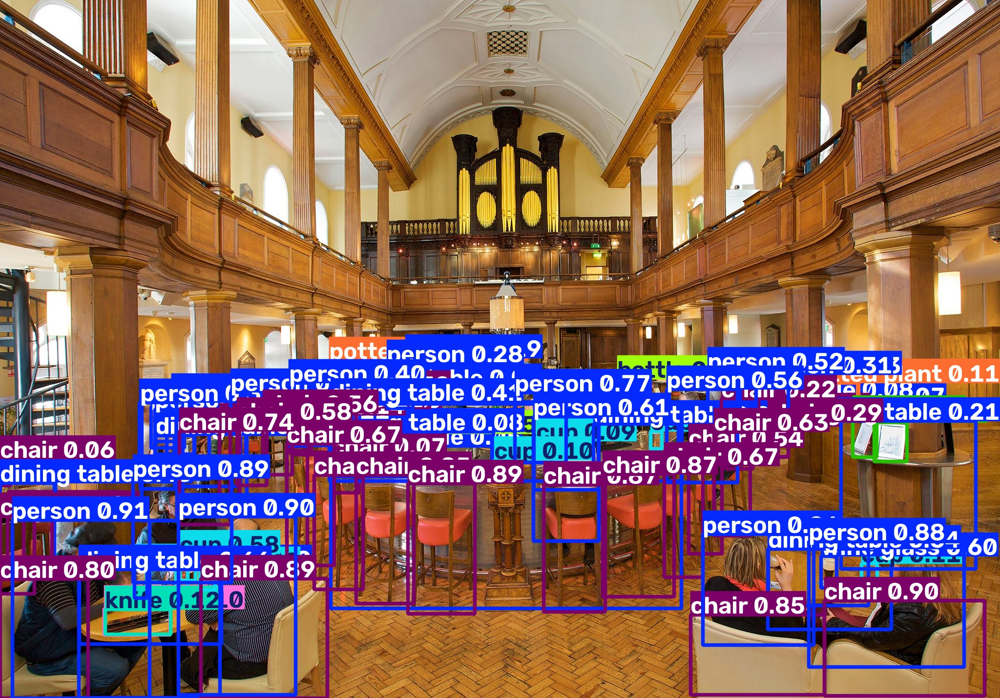
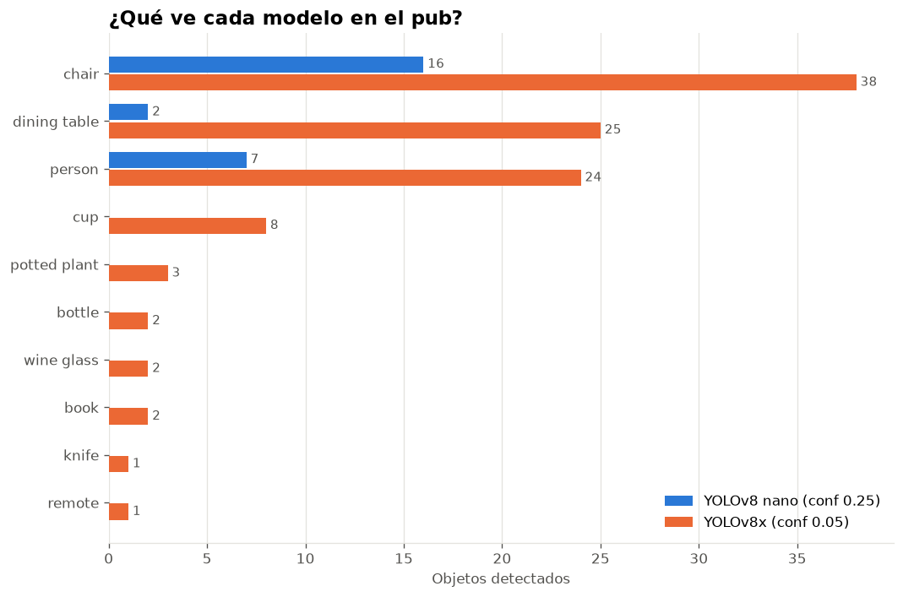
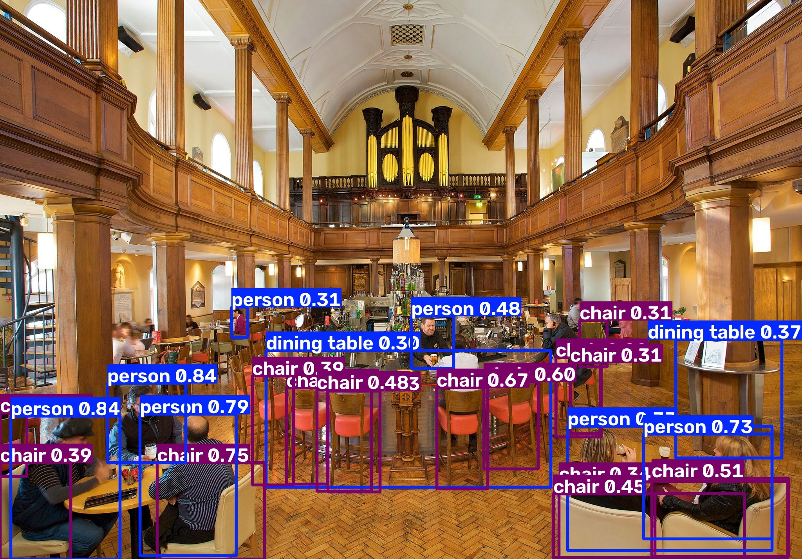

# 🍺 ¿Cuánta gente hay en el pub? De 25 a 106 objetos con YOLOv8

> Detección de objetos con **YOLOv8** sobre una foto real de un pub de Dublín: personas, sillas, mesas, copas y botellas localizadas automáticamente con su nivel de confianza y sus coordenadas. Y un experimento: ¿qué cambia al pasar del modelo más pequeño al más grande?



## ⚔️ Nano contra extra-grande

| | YOLOv8 **nano** | YOLOv8 **x** (extra-grande) |
| --- | --- | --- |
| Tamaño de los pesos | ~6 MB | ~137 MB |
| Confianza mínima (`conf`) | 0.25 (por defecto) | 0.05 |
| **Objetos detectados** | **25** | **106** |
| Categorías distintas | 3 | 10 |



**Qué nos dice:**
- El modelo nano es rápido y ligero, pero solo ve lo evidente: personas, sillas y mesas.
- YOLOv8x, con el umbral de confianza muy bajo, encuentra también tazas, copas, botellas, plantas y hasta un cuchillo.
- El precio de bajar `conf` a 0.05: aparecen detecciones dudosas (p. ej. un "remote" o cajas con confianza 0.06). Subir `conf` a ~0.5 da un resultado más limpio.

| YOLOv8 nano | YOLOv8x |
| --- | --- |
|  |  |

## 🧠 Qué se practica

- Cargar un modelo **preentrenado** de YOLO (`YOLO("yolov8n.pt")`); el `.pt` contiene los pesos, como un `.keras` en Keras.
- Ejecutar la detección con `modelo.predict(imagen, conf=...)` y controlar el umbral de confianza.
- Recorrer `resultado.boxes` para obtener de cada objeto:
  - la clase (`caja.cls` → `modelo.names`),
  - la confianza (`caja.conf`, de 0 a 1),
  - las coordenadas de la caja (`caja.xyxy`: x1 izquierda, y1 arriba, x2 derecha, y2 abajo).
- Contar los objetos por categoría con un diccionario.
- Detección **en tiempo real con la webcam** (`source=0`, `stream=True`) para avisar cuando aparece una botella.

## 📁 Estructura del proyecto

| Archivo | Descripción |
| --- | --- |
| [`cafeteria-dublin.jpg`](cafeteria-dublin.jpg) | Foto original del pub. |
| [`YOLO_detectar.py`](YOLO_detectar.py) | Detección básica con YOLOv8 nano: guarda la imagen anotada y cuenta los objetos. |
| [`YOLO_DETECTAR_MASCOMPLEJO.py`](YOLO_DETECTAR_MASCOMPLEJO.py) | Detección con YOLOv8x: clase, confianza y coordenadas de cada objeto y conteo por categoría. |
| [`comparar_modelos.py`](comparar_modelos.py) | Ejecuta los dos modelos y genera la gráfica comparativa. |
| [`cam_tetection.py`](cam_tetection.py) | Detección en directo con la cámara del ordenador; avisa al ver una botella. |
| [`imagenes/`](imagenes/) | Resultados generados. |

## ▶️ Cómo ejecutarlo

```bash
pip install -r requirements.txt
python YOLO_detectar.py                # modelo nano
python YOLO_DETECTAR_MASCOMPLEJO.py    # modelo extra-grande, con detalle por objeto
python comparar_modelos.py             # gráfica comparativa
python cam_tetection.py                # webcam (cerrar con Ctrl+C)
```

La primera vez, `ultralytics` descarga automáticamente los pesos (`yolov8n.pt`, `yolov8x.pt`), por eso no están en el repositorio.

## 📷 Sobre la foto

La imagen muestra el interior de **[The Church Bar & Restaurant](https://thechurch.ie/about/history/)**, en Mary Street (Dublín): la antigua iglesia de St Mary's, de principios del siglo XVIII, con su característico órgano Renatus Harris y sus galerías de madera.

La foto se obtuvo de internet y **no es de autoría propia**; se desconoce su autor original. Se usa únicamente con fines educativos y sin ánimo de lucro, como ejemplo de detección de objetos. Si eres el titular de los derechos y quieres que se cite tu autoría o que se retire, abre un *issue* en este repositorio.

---

Ejercicio del curso **Big Data con Python (sector sanitario)**.
